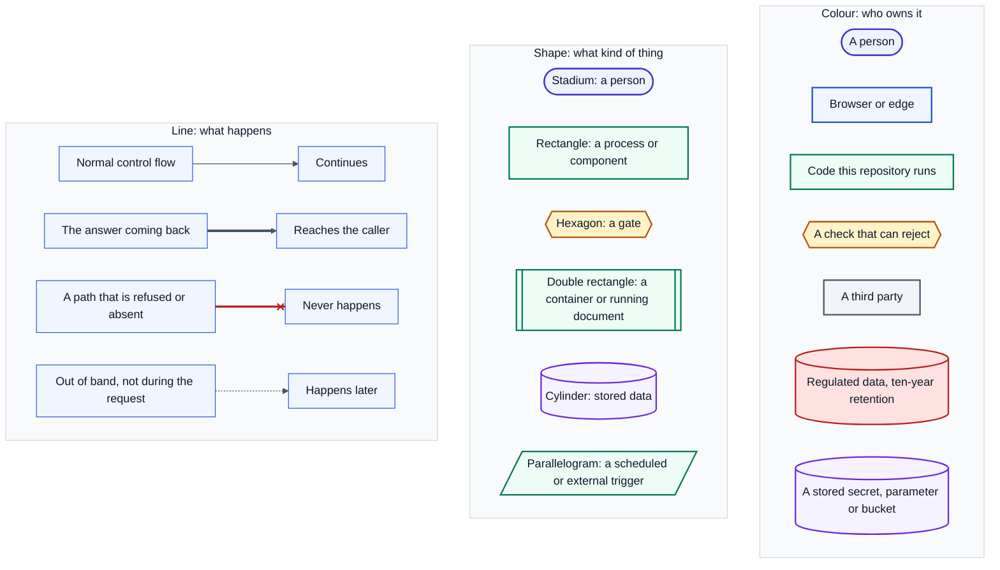
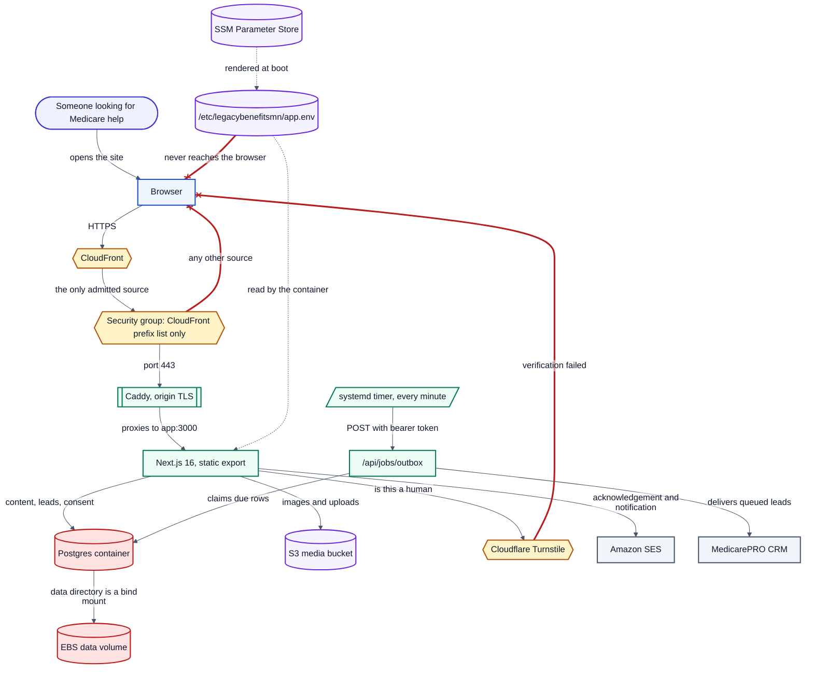
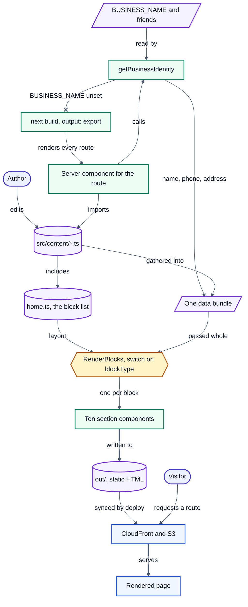
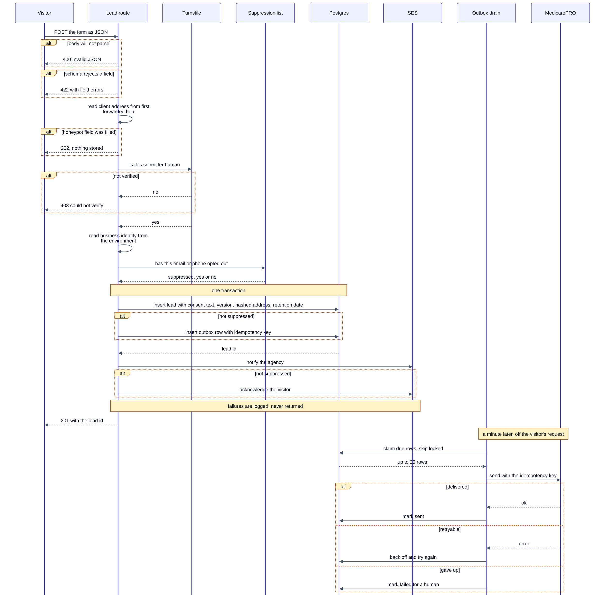
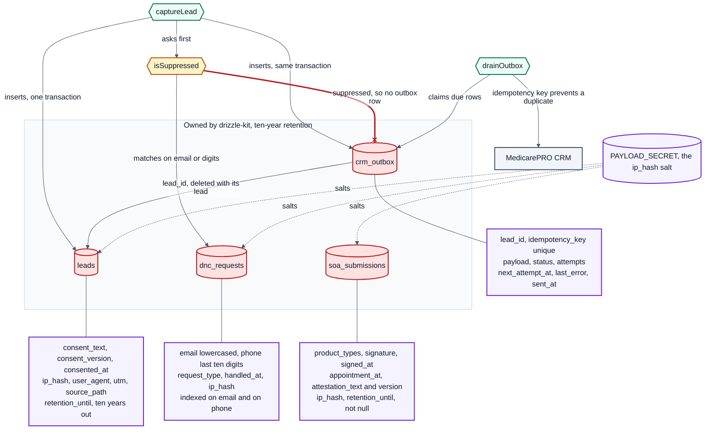
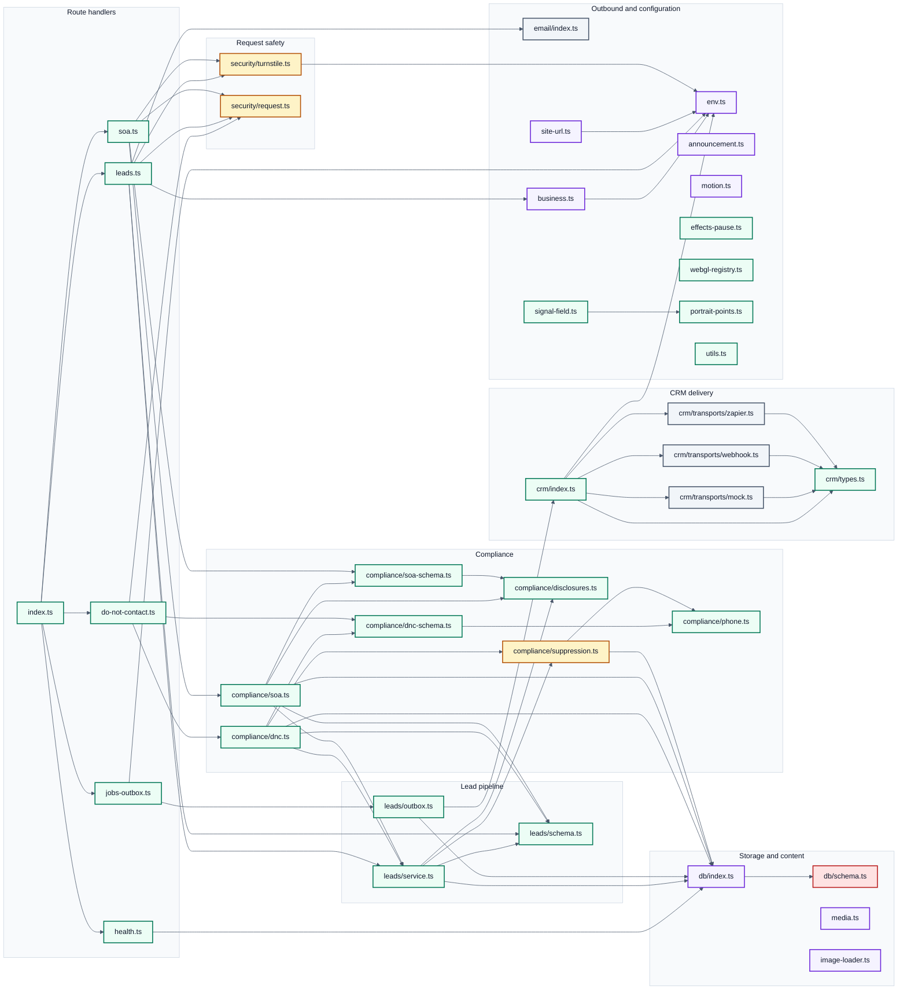
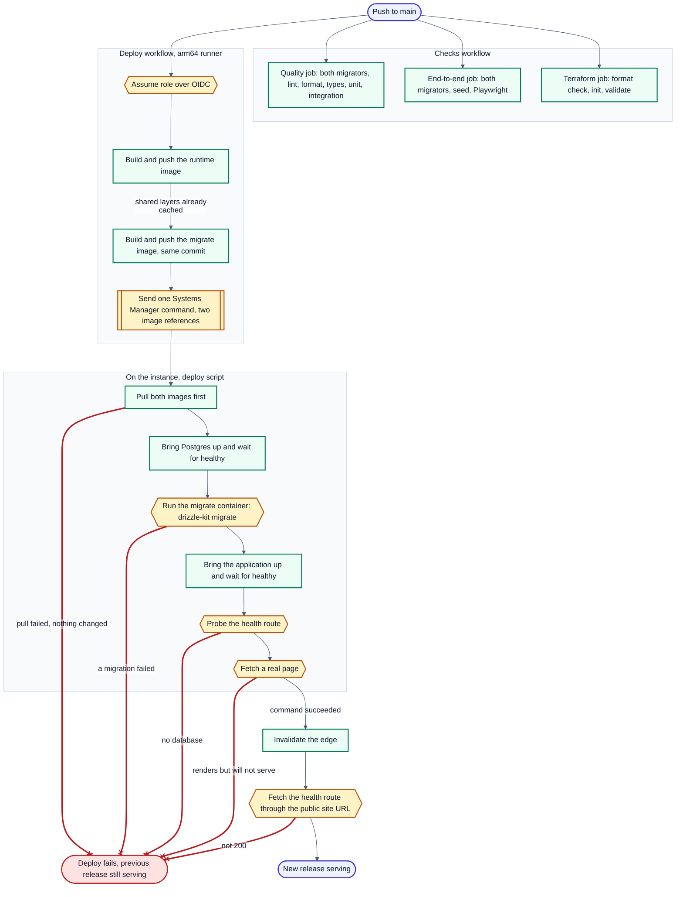
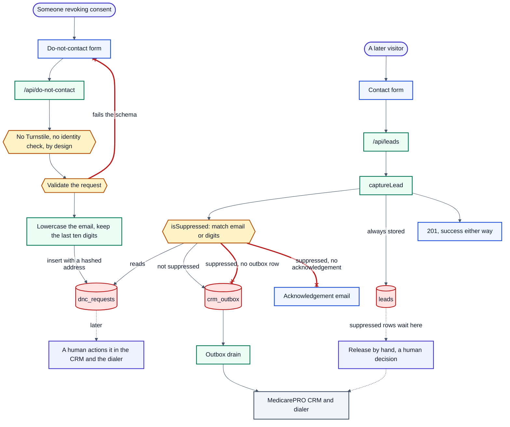

# Diagram sources

Every diagram in this atlas, one fence each, in `LEGEND` then `D1` through `D8` order.
Each fence is byte-identical to the `.mmd` file beside it.

This file is generated. Run `pnpm diagrams:build` to rewrite it; never edit it by hand.

The key — shapes, colours and line styles

D1 — how a visitor reaches the site

D2 — a content module to a rendered page

D3 — a form submission, click to CRM

D4 — the four regulated tables

D5 — every server module and its imports

D7 — push to serving release

D8 — a stop request, taken and enforced

